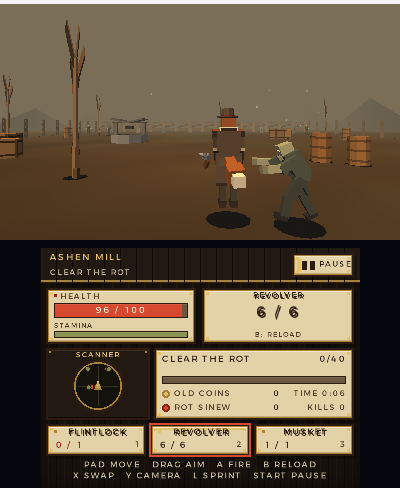

# Attempt 3: Gravepowder for the 3DS

A 3D zombie shooter I'm building for the Nintendo 3DS, from scratch in C. Anthro wolf gunslinger,
flintlock-era iron, shambling rot, and a valley split into zones you clear one dusty yard at a time.

This is the follow-up to [Elemental Defense](https://github.com/Mist-Eros/Attempt-2-3ds-game) (the
maze-building tower defense I ported to the 3DS last time). Same approach, harder problem: real 3D,
so a citro3d scene now has to grow into a game. No engine, no asset packs — every mesh and every
sound is generated by the code in this repo.


## What the game is

You're a wolf-folk gunslinger who walked into a valley the dead have overrun. Old guns only:

- **Flintlock pistol** — one shot, hits like a mule, slow to reload.
- **Cap-and-ball revolver** — six shots, the practical choice.
- **Long musket** — one shot, brutal damage, long range, takes forever to reload.

The valley is split into **zones**, Borderlands-like. Each zone has a job: clear out the rot, or
bring back a material the survivors need. Zombies drop old coins and rot sinew; those are the
things the quest asks for. Clear the job, move on.

Two camera modes: **third person** (default — you see the wolf, coat, tail and the gun at his hip)
and **first person**, toggled with **Y** or in the pause settings.

### v0.1 — Ashen Mill (the first playable)

One complete zone: a walled mill yard with fence, gate, crates, barrels, a well, dead trees and
tombstones. The job: **clear 40 of the rot, then bring back 8 old coins and 4 rot sinew** from the
drops. Three zombie types (shambler, runner, brute) in waves, three guns, ammo/reloads, pickups,
health, pause/settings, quest tracker and radar on the touch screen.

| Title | Third person | First person |
|---|---|---|
|  |  |  |

| Firing (reload in progress) | Weapon switch | Pause |
|---|---|---|
|  |  |  |

## Playing it

Grab `Gravepowder.3dsx` from the [releases page](https://github.com/Mist-Eros/Attempt-3-3ds-gravepowder/releases),
drop it in `/3ds/` on your SD card, launch it from the Homebrew Launcher. Needs a 3DS with homebrew
(Luma3DS/CFW or any entry point that can run `.3dsx` files).

### Controls

| Input | Action |
|---|---|
| Circle pad | move |
| Touchscreen drag | aim / look (tap = UI buttons only) |
| A | fire |
| B | reload |
| X | switch weapon |
| Y | toggle first / third person |
| L | sprint |
| Start | pause / resume |

Playing under an emulator (I use Azahar)? Same mapping as my last project: **arrow keys** are the
circle pad, **WASD** the d-pad, **U/H/J/K** = X/Y/B/A, **Q/I** = L/R, **M/N** = Start/Select, and the
mouse on the bottom screen is the touchscreen (click = tap, drag = aim).

### Sound

Music and the gun/zombie sounds are original, synthesized from scratch by `tools/make_audio.py` and
linked into the `.3dsx` (raw PCM, no extra files on the SD card). Event-driven SFX plus two music
loops (menu, zone).

One caveat: the 3DS audio service needs the **DSP1 firmware** loaded. On Luma3DS that usually means
having DSP1 installed/enabled; if it's missing, the game detects `ndspInit()` failing and just runs
silently instead of crashing.

## Status

**v0.1: first playable zone.** Everything above works in Azahar (60 fps, both camera modes, touch
aim, pause/settings, weapon switching, quest tracking). Still to come:

- [ ] real-hardware playtest (input feel, 3D depth, audio) — the build only ran in Azahar so far
- [ ] zoned hub ("trail" screen) so you walk between zones; save file on the SD card
- [ ] more zones (Bone Orchard / Old Mine) with their own quests and a boss-ish brute
- [ ] shop / gun upgrades and more flintlock-era iron
- [ ] hero model swap: the wolf is placeholder-ish low-poly; the user's own model will replace it

## Building it

You need [devkitPro](https://devkitpro.org/wiki/Getting_Started) with the 3DS dev packages. On a
normal devkitPro install:

```sh
pacman -S 3ds-dev
cd Attempt-3-3ds-gravepowder
make
```

That produces `Gravepowder.3dsx`, `Gravepowder.elf` and the `.smdh` metadata. Copy the `.3dsx` to
your SD card and you're away. Every push, and every `v*` tag, builds it in GitHub Actions.

Host tests and the headless gameplay sim:

```sh
make -C tests CC=cc test     # any C compiler
make -C tools CC=cc run     # headless bot plays Ashen Mill
```

## How it's put together

```
include/grave.h      portable game contract (types, pools, events, input)
include/render3d.h   3D front-end contract (targets, scene, draw world, hero rig swap)
include/app.h        app/UI contract
source/core/         portable C99 simulation: player, guns, zombies, drops, quests, camera
source/render3d.c    citro3d: shaders, zone, low-poly wolf, zombies, guns, effects
source/mesh.c/h      procedural mesh builders + the HeroRig swap format
source/ui.c          citro2d bottom screen: HUD, radar, title/pause/results pages
source/app.c         scene state machine + input mapping + audio dispatch
source/main.c        aptMainLoop frame loop (fixed 60 Hz steps)
source/audio.c       portable audio fallback (host tools)
source/audio_3ds.c   libctru ndsp mixer for the 3DS build
tools/make_audio.py  synthesizes every sound and music loop
tests/ tools/sim.c   host unit tests + headless autoplay sim
```

The core is plain C99, no malloc in the loop, deterministic from a seed. The renderer only reads
core state; every gameplay number lives in `source/core/data.c`.

## Swapping in the real hero model

The wolf is a procedural placeholder. When you send your own model, it plugs into
`r3d_set_hero_rig()` — see `HeroRig` in `source/mesh.h` (parts with parent/joint pivot + animation
channels). Any format I can convert into that rig works (glTF/OBJ + a short description of the bones
you want animated: head, ears, tail, arms, legs, coat).

## Credits

- [devkitPro](https://devkitpro.org/), libctru, citro3d and citro2d — no homebrew without them.
- [font8x8](https://github.com/dhepper/font8x8) (public domain) for the early title prototype;
  the shipping UI uses citro2d's system font.
- Everything in the game — meshes, textures-as-vertex-colours, sounds and music — is generated by
  the code in this repo. No ripped assets.
- The wolf, the valley and the very bad idea of a flintlock-only zombie apocalypse are mine.
