# Attempt 3: Gravepowder for the 3DS

A 3D zombie shooter for the Nintendo 3DS, built from scratch in C. Anthro wolf gunslinger, flintlock-era
iron, shambling rot, and a valley split into zones you clear one dusty yard — and one haunted mine — at a time.

This is the follow-up to [Elemental Defense](https://github.com/Mist-Eros/Attempt-2-3ds-game) (the
maze-building tower defense I ported to the 3DS last time). Same approach, harder problem: real 3D on
a 240p handheld, with **free CC0/CC-BY models** (skinned and animated) so it doesn't look like
programmer art anymore.

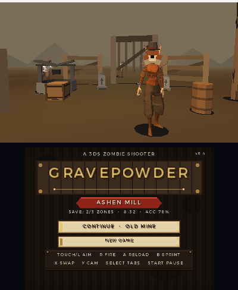

## What the game is

You're a wolf-folk gunslinger (working name: Rook) who walked into a valley the dead have overrun.
Old guns only:

- **Flintlock pistol** — one shot, hits like a mule, slow to reload.
- **Cap-and-ball revolver** — six shots, the practical choice.
- **Long musket** — one shot, brutal damage, long range, takes forever to reload.

The valley is split into **zones**, Borderlands-style. Each zone has a job: clear out the rot, or
bring back a material the survivors need. Zombies drop old coins, rot sinew and (in the orchard) bone
charms — those are what the quests ask for. Clear the job, unlock the next zone, walk on.

**The campaign:**

- **ASHEN MILL** — the walled mill yard. Kill 40 of the rot, bring back 8 old coins and 4 rot sinew.
- **BONE ORCHARD** — a dense graveyard (143 props), runner-heavy waves with a brute every wave. Kill
  55, bring back 10 old coins and 6 bone charms.
- **OLD MINE** — a proper mine-works finale: timber adits, ore glows, carts and lanterns in low amber
  fog. Kill 45, bring back 8 old coins and 3 bone charms... and survive **the Foreman**, a 2.8 m boss
  with 1680 HP that bursts out of the dark once you've put down 40 of his crew.
- **The Trader** waits at the trailhead. Old coins, rot sinew and bone charms finally have a sink:
  ammo refills, per-gun damage tunes, max HP, faster reloads, medkits.
- **World map travel**: clear a zone, then travel between zones from the WORLD page. Progress, materials,
  owned guns, shop upgrades and settings are saved to the SD card (`save.bin` v3), so the valley
  remembers — the title screen offers CONTINUE or NEW GAME.

Two camera modes: **third person** (default — you see the wolf, coat, tail and the gun at his hip) and
**first person**, toggled with Y or in settings.

### Screens

| Title (CONTINUE) | Old Mine, third person | Old Mine, first person |
|---|---|---|
|  | 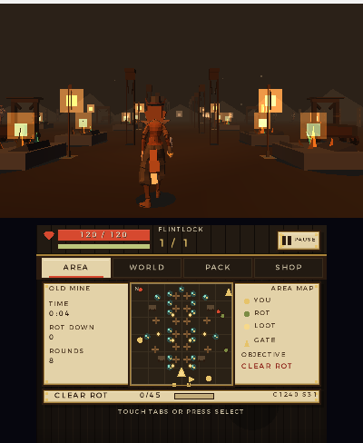 | 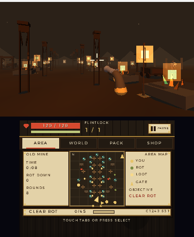 |

| Aiming, first person | Aiming, third person | Firing while aimed |
|---|---|---|
| 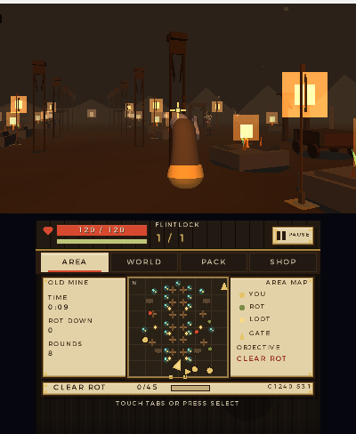 | 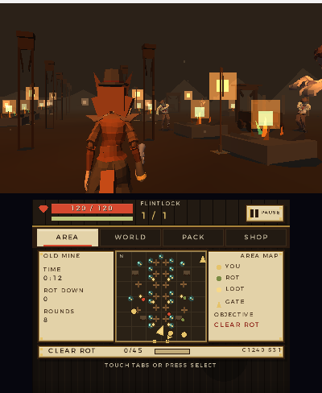 | 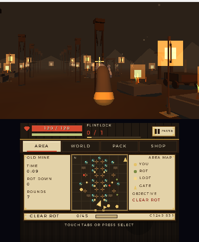 |

| Mine area map | World map | Inventory |
|---|---|---|
| 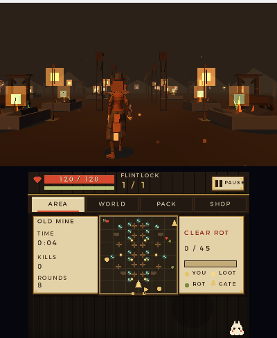 | 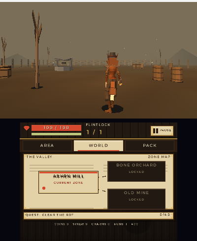 | 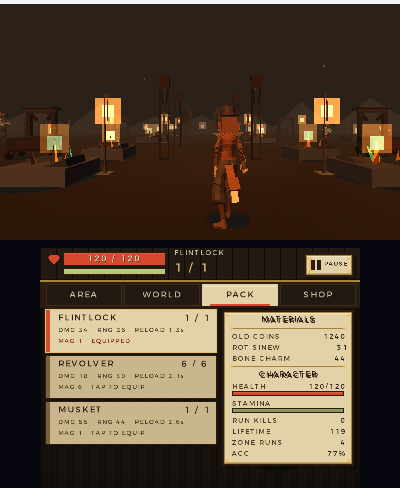 |

| The Trader (offline UI render) | The Foreman (offline render) | Ending |
|---|---|---|
| 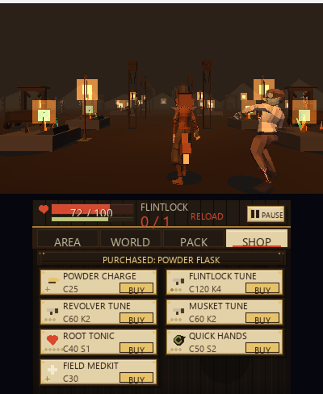 | 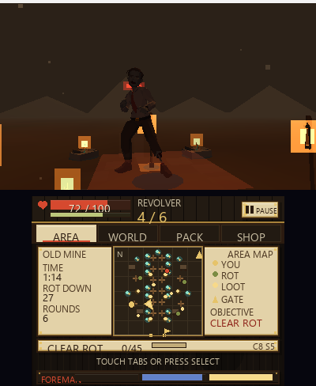 | 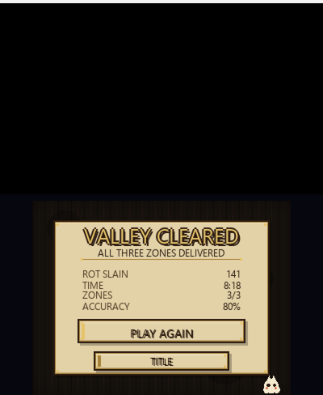 |

| Pause | Wardrobe / model swap | Settings (gyro, sensitivity) |
|---|---|---|
| 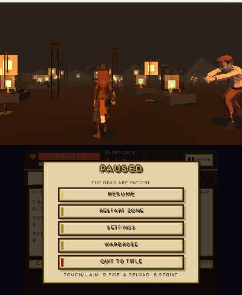 | 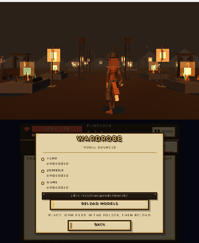 | 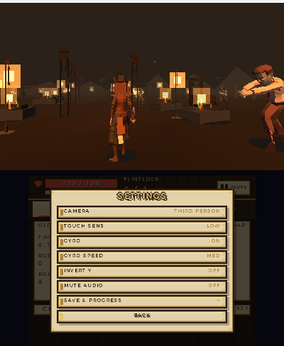 |

(The title, mine, maps, inventory, pause and wardrobe shots are emulator captures. The Trader, Foreman
and ending pages are rendered offline from the game's own draw lists because reaching them on the
emulator needs a full playthrough — the 3D backgrounds are real renderer captures.)

## The bottom screen is a paged info screen

Top screen is the 3D gameplay. Bottom screen has a slim always-on strip (health/stamina, weapon/ammo,
reload bar, pause) plus **four tabs** — touch them, or press **Select** to cycle:

- **AREA** — top-down map of the current zone: all props (timber, carts, ore, lanterns...), walls, gate,
  your facing arrow, live zombie blips (boss is a bigger red blip), loot dots, objective + quest progress.
- **WORLD** — the valley: zone nodes with locked/cleared/current state, NEW badges, best times, material
  summary; tapping an unlocked zone opens a travel confirmation instead of teleporting.
- **PACK** — inventory: weapon cards with stats/ammo (tap to equip), materials, character sheet with
  accuracy, lifetime kills, zone runs.
- **SHOP** — the Trader's catalog (only buyable at the trailhead): ammo, three gun tunes, vitality,
  quick hands, medkits; BUY/MAXED/LOCKED states, wallet in the header.

**Wardrobe** (pause menu) shows where each model came from (SD card / embedded / procedural fallback)
and reloads all models from the SD card in one tap — the in-game door for swapping models.
When the Foreman is on the field a three-segment boss bar is pinned to the bottom edge.

## Playing it

Grab `Gravepowder.3dsx` (and optionally `Gravepowder-models.zip`) from the
[releases page](https://github.com/Mist-Eros/Attempt-3-3ds-gravepowder/releases), drop the `.3dsx`
in `/3ds/` on your SD card, launch it from the Homebrew Launcher. Needs a 3DS with homebrew
(Luma3DS/CFW or any entry point that can run `.3dsx` files).

### Controls

| Input | Action |
|---|---|
| Circle pad | move (camera-relative, properly oriented: left is left) |
| Touchscreen drag | look / fine aim (still works, 0.6× sensitivity while aiming) |
| **R (hold)** | **fire** |
| **L (hold)** | **aim** — raises the gun, tightens the reticle, narrows the camera to 50°, steadies the weapon and enables the small aim assist cone |
| A | reload |
| B (hold) | sprint |
| X | switch weapon |
| Y | toggle first / third person |
| **Gyro** | **turn/look by moving the console** — on by default (settings: ON / OFF / INVERT, sensitivity LOW / MED / HIGH) |
| New 3DS C-stick | camera turn fallback (left/right yaw, up/down pitch) |
| Select | cycle bottom-screen pages |
| Touch tabs | switch pages / tap nodes, weapon cards, shop items, buttons |
| Start | pause / resume |

Playing under an emulator (Azahar)? Arrow keys = circle pad, WASD = d-pad, **U/H/J/K** = X/Y/B/A,
**Q/I** = L/R, **M/N** = Start/Select, and the mouse on the bottom screen is the touchscreen.
(Emulators usually report zero gyro motion — the game handles that silently; touch/stick aiming still works.)

### Aiming and turning

Hold **L** to aim: the view zooms to 50°, the third-person camera pulls in, the imported gun rises and centres,
the reticle tightens to a gold cross, spread drops to about a third and recoil is cut — plus a small 3°
aim-assist cone when your shot would otherwise just miss. **R** fires.

Turning is handled by the **gyroscope** (on by default): rotate the console to look around, with a deadzone and
three sensitivity presets in SETTINGS. If your unit's yaw reads backwards, set **GYRO: INVERT**. On a New 3DS
the **C-stick** also turns the camera. Touch-drag still aims for anyone who prefers it, and movement now
accelerates/decelerates instead of snapping, so strafing and kiting feel less clunky.

### Sound

Music and the gun/zombie sounds are original, synthesized from scratch by `tools/make_audio.py` and
linked into the `.3dsx` (raw PCM, no extra files needed). The 3DS audio service needs **DSP1
firmware** (Luma3DS); if it's missing the game runs silently instead of crashing.

## Models and licences

The hero body, zombies and guns are free models (see [`assets/LICENSES.md`](assets/LICENSES.md)):

| What | Model | Licence |
|---|---|---|
| Hero body (24 animations) | Quaternius *Medieval* | CC0 |
| Wolf head / ears / tail | procedural, attached to the imported skeleton | original |
| Animated zombie (13 animations) | *Animated Zombie* by bachosoftdesign | CC-BY 3.0 |
| Flintlock pistol / musket | Quaternius Pistol / Rifle | CC0 |
| Revolver | *Revolver* by zeilmannnoah | CC-BY 3.0 |

Models are converted from glTF to a small fixed binary format (`GPM`) by `tools/import_model.py` and
embedded in the `.3dsx`. No ripped assets are used or redistributed.

## Swapping models

Converted models live in `data/models/` and are embedded, but a copy on the SD card overrides the
embedded model at runtime — you can swap the hero/zombie/guns **without rebuilding the game**:

```
E:\3ds\Gravepowder\models\hero.gpm
E:\3ds\Gravepowder\models\zombie.gpm
E:\3ds\Gravepowder\models\gun_flintlock.gpm
E:\3ds\Gravepowder\models\gun_revolver.gpm
E:\3ds\Gravepowder\models\gun_musket.gpm
```

Delete a file to fall back to the embedded model. `Gravepowder-models.zip` in the release contains
the whole folder ready to unzip at the SD root.

To convert a model of your own:

```sh
pip install pygltflib numpy Pillow
python tools/import_model.py assets/models/mymodel.glb --config assets/import/hero.json --out data/models/hero.gpm
tools\convert_assets.cmd      # or just this: converts every assets/import/*.json in one go
make                          # re-embed (only needed for the built-in copy)
```

Config JSONs (`assets/import/*.json`) say which mesh parts to export, which source animation maps to
which gameplay role (`idle`/`walk`/`run`/`shoot|attack`/`hit`/`death`), scale/orientation and colour
tints. Full format + workflow in [`docs/assets.md`](docs/assets.md) and
[`tools/README.md`](tools/README.md). The user's own wolf model will be slotted in the same way.

## Status

v0.4 "Steady Hands" fixes real-hardware feel: the strafe/turn axes were mirrored (left moved right) and there
was no way to turn around — both are fixed. **R fires, L aims, A reloads, B sprints**, gyro turns the view
(INVERT option), the New 3DS C-stick works as a camera fallback, aiming zooms/steadies with an assist cone,
and movement accelerates smoothly. The campaign itself is unchanged: three zones, the Foreman boss, the
Trader's shop, save v3 (old saves still load), WARDROBE model swap, four-tab touch UI, ending. 57 fps in
every measured scene, animated models in both camera modes, original music/SFX.

Still to do:

- [ ] real-hardware playtest of v0.3 (3D, touch aim, model animation, audio, shop loop)
- [ ] bring your own wolf model (the WARDROBE page + GPM pipeline are the swap path)
- [ ] weapon variants / more guns; boss attack variety
- [ ] optional post-game endless mode beyond the mine
- [ ] performance headroom: skinned-vertex budget is the limit in dense mine fights

## Building it

You need [devkitPro](https://devkitpro.org/wiki/Getting_Started) with the 3DS dev packages:

```sh
pacman -S 3ds-dev
make
```

That produces `Gravepowder.3dsx`, `Gravepowder.elf` and the `.smdh`. The converted models are
committed, so a normal build needs no Python; only re-converting models does (see above). Host tests
and the headless campaign sim:

```sh
make -C tests CC=cc test     # 4024 checks
make -C tools CC=cc run     # bot clears all 3 zones incl. the Foreman
make -C tools/preview CC=cc run  # offline UI page tour + layout/legibility check
```

Every push and every `v*` tag builds it in GitHub Actions.

## How it's put together

```
include/grave.h      portable game contract (world, quests, inventory, save, input)
include/gpm.h        model format loader API
include/skin.h       CPU skinning + animation sampling API
include/render3d.h   3D front-end contract (targets, scene, draw world, model swap)
include/app.h        app/UI contract
include/audio.h      audio contract

source/core/         portable C99 simulation (no <3ds.h>): player, guns, zombies, drops,
                     world/travel, quests, camera, save image
source/gpm.c         GPM model loader (embedded or SD override)
source/skin.c        rigid-bone CPU skinning, clip sampling, crossfade, LOD
source/mesh.c        procedural fallback meshes + wolf head/tail attachments, props, effects
source/render3d.c    citro3d world rendering, camera, lighting, particles
source/ui.c          citro2d paged bottom screen (strip + AREA/WORLD/PACK/SHOP + pause pages)
source/app.c         scene state machine, input, save I/O, audio dispatch
source/main.c        aptMainLoop frame loop (fixed 60 Hz)
source/audio*.c      portable fallback + libctru ndsp mixer
assets/              free CC0/CC-BY model sources + conversion configs + licences
tools/               importer, selftest, asset convert/install scripts, audio synth, sim
tools/preview/       host page-tour harness for ui/app (draw-list replay + layout checks)
tests/               host unit tests
```

The core is plain C99, no malloc in the loop, deterministic from a seed. The renderer only reads core
state; gameplay numbers live in `source/core/data.c`; models are data, not code.

## Credits

- [devkitPro](https://devkitpro.org/), libctru, citro3d and citro2d.
- Model assets (CC0/CC-BY) as listed above and in [`assets/LICENSES.md`](assets/LICENSES.md):
  Quaternius (hero body, pistol, rifle), bachosoftdesign (animated zombie, CC-BY 3.0), zeilmannnoah (*Revolver*, CC-BY 3.0).
- Everything else — the wolf head/ears/tail, props, effects, UI art, sounds and music — generated by
  the code in this repo.
- The wolf, the valley and the very bad idea of a flintlock-only zombie apocalypse are mine.
